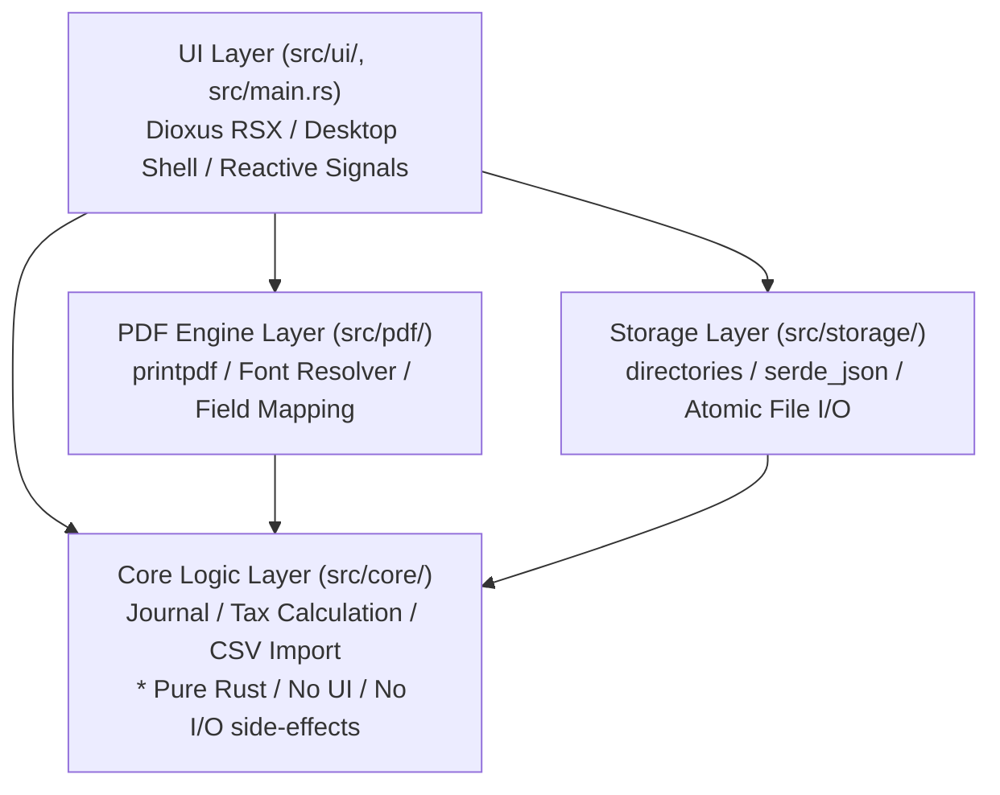

# Tax Return Application Architecture Design

This document details the **internal software architecture, modular boundaries, data structures, technology stack, and testing strategy** of `TaxReturnApplication-Dioxus`.

---

## 1. System Architecture Overview

### 1.1 Layered Design and Dependency Graph
The codebase enforces strict separation among the **UI layer**, **pure accounting/tax logic**, **persistence storage**, and **PDF rendering engine**.



### 1.2 Core Architectural Principles
1. **Core Logic Purity**:
   - Modules under `src/core/` have no dependencies on the UI crate (Dioxus) or filesystem/network I/O.
   - All accounting algorithms are written as pure functions (`fn calculate(input: &Input) -> Output`), making them 100% testable in a headless environment.
2. **Library vs. Binary Decoupling**:
   - `src/lib.rs` exports only `core`, `pdf`, and `storage`. This allows running `cargo test --lib --no-default-features` instantly without installing GUI system libraries (such as GTK / WebKitGTK).
   - `src/main.rs` manages the desktop application lifecycle and window orchestration.
3. **Single Binary Delivery**:
   - The compiled release is a self-contained executable binary with zero external runtime dependencies (no Node.js, Electron, or Python).

---

## 2. Directory & Module Structure

```
TaxReturnApplication-Dioxus/
├── Cargo.toml               # Dependencies, feature flags, profile settings
├── Dioxus.toml              # Dioxus CLI configuration
├── assets/
│   ├── styles.css           # Global UI stylesheet embedded into the shell
│   └── fonts/               # Directory for bundled CJK TrueType/OpenType fonts
├── templates/
│   ├── blue_return_fields.json # External field coordinates for Blue Return PDF
│   └── form_b_fields.json      # External field coordinates for Form B PDF
├── src/
│   ├── lib.rs               # Library entry point (core, storage, pdf)
│   ├── main.rs              # Desktop window entry point and AppState provider
│   ├── core/                # Pure accounting and tax calculation engine
│   │   ├── mod.rs
│   │   ├── journal.rs       # Journal models, chart of accounts, sub-accounts, validation
│   │   ├── allocation.rs    # Home-office allocation engine, business use ratio computation
│   │   ├── rollover.rs      # Fiscal year rollover engine, balance carry-forward, opening entries
│   │   ├── tax_calc.rs      # P&L aggregations, dynamic expense calculations, tax brackets
│   │   └── csv_import.rs    # Legacy 2-row CSV parser, encoding & account mapping
│   ├── storage/             # Filesystem persistence layer
│   │   ├── mod.rs
│   │   ├── paths.rs         # OS data directories resolution (directories crate)
│   │   └── json_store.rs    # Per-year atomic JSON load and save
│   ├── pdf/                 # PDF generation layer
│   │   ├── mod.rs
│   │   ├── field_map.rs     # Field coordinate models and JSON loaders
│   │   ├── fonts.rs         # Japanese font discovery and fallback resolver
│   │   └── engine.rs        # printpdf rendering pipeline
│   └── ui/                  # Dioxus RSX user interface components
│       ├── mod.rs
│       ├── layout.rs        # Sidebar chrome and 3-screen navigation router
│       ├── ledger.rs        # Ledger input form, table, sub-accounts, CSV UI
│       ├── report.rs        # Tax summary cards, profile form, PDF triggers
│       └── closing.rs       # Closing & Settings (accounts, home-office allocation, rollover)
└── doc/                     # Specifications, architecture, and roadmaps
```

---

## 3. Core Data Structures

### 3.1 Bookkeeping Models (`src/core/journal.rs`)

```rust
// Account classification
pub enum AccountNature {
    Asset,
    Liability,
    Equity,
    Income,
    Expense,
}

// Chart of accounts (serialized as snake_case)
pub enum AccountCode {
    Cash, Bank, AccountsReceivable, AccountsPayable,
    Capital, Drawings, OwnerContribution,
    Sales, CostOfSales, Travel, Communication, Supplies,
    Rent, Utilities, Miscellaneous,
}

// Single double-entry journal line
pub struct JournalEntry {
    pub id: String,                    // UUID v4
    pub date: NaiveDate,               // Transaction date
    pub debit: AccountCode,            // Debit account
    pub credit: AccountCode,           // Credit account
    pub amount: i64,                   // Amount in JPY (integers only)
    pub description: String,           // Memo / description
    pub created_at: DateTime<Local>,   // Creation timestamp
}

// Taxpayer profile
pub struct TaxpayerInfo {
    pub name: String,
    pub address: String,
    pub business_name: String,
    pub phone: String,
}

// Fiscal year root document (stored JSON payload)
pub struct LedgerDocument {
    pub version: u32,                  // Schema version (currently 2)
    pub fiscal_year: i32,              // Fiscal year (e.g. 2026)
    pub entries: Vec<JournalEntry>,    // Journal entries
    pub taxpayer: TaxpayerInfo,        // Taxpayer metadata
    pub special_deduction: BlueSpecialDeductionKind, // Deduction tier
}
```

### 3.2 Tax Calculation Models (`src/core/tax_calc.rs`)

```rust
// Blue return special deduction tier
pub enum BlueSpecialDeductionKind {
    None,      // 0 JPY
    Yen100k,   // 100,000 JPY
    Yen650k,   // 650,000 JPY
}

// Breakdown of expenses
pub struct ExpenseBreakdown {
    pub travel: i64,
    pub communication: i64,
    pub supplies: i64,
    pub rent: i64,
    pub utilities: i64,
    pub miscellaneous: i64,
}

// Aggregation summary for Blue Return P&L statement
pub struct BlueReturnSummary {
    pub fiscal_year: i32,
    pub sales: i64,
    pub cost_of_sales: i64,
    pub gross_profit: i64,
    pub expenses: ExpenseBreakdown,
    pub total_expenses: i64,
    pub ordinary_income_before_deduction: i64,
    pub special_deduction_kind: BlueSpecialDeductionKind,
    pub special_deduction: i64,
    pub business_income: i64,
    pub by_account: BTreeMap<String, i64>,
    // Balance sheet balances
    pub cash: i64,
    pub bank: i64,
    pub accounts_receivable: i64,
    pub accounts_payable: i64,
    pub capital: i64,
    pub drawings: i64,
    pub owner_contribution: i64,
}

// Form B income tax estimation
pub struct FormBSummary {
    pub fiscal_year: i32,
    pub business_income: i64,
    pub total_income: i64,
    pub basic_deduction: i64,
    pub total_deductions: i64,
    pub taxable_income: i64,
    pub income_tax: i64,
    pub reconstruction_surtax: i64,
    pub total_income_tax: i64,
}
```

### 3.3 CSV Parsing Models (`src/core/csv_import.rs`)

```rust
// Report generated after parsing legacy CSV
pub struct CsvImportReport {
    pub entries: Vec<JournalEntry>,
    pub warnings: Vec<String>,
    pub errors: Vec<CsvRowError>,
    pub total_data_rows: usize,
    pub skipped_rows: usize,
}

// Row-level error descriptor
pub struct CsvRowError {
    pub row_index: usize,
    pub line_number: usize,
    pub message: String,
    pub raw_data: String,
}
```

---

## 4. UI State Management & Reactivity

### 4.1 Application State (`AppState`)
Global reactive state is provided via Dioxus context signals (`Signal<AppState>`):

```rust
pub struct AppState {
    pub fiscal_year: i32,
    pub entries: Vec<JournalEntry>,
    pub taxpayer: TaxpayerInfo,
    pub special_deduction: BlueSpecialDeductionKind,
    pub status_message: Option<String>,
    pub error_message: Option<String>,
}
```

- **Auto-Persistence**: Any modification (adding/updating/deleting transactions, editing taxpayer info, selecting deduction tiers) automatically invokes `save_year` in the background.
- **Immediate User Feedback**: Success messages and validation/IO errors are presented via responsive banner alerts.

### 4.2 Linux / WSL2 WebKitGTK Rendering Safeguards
To prevent blank windows or GPU compositing crashes under Linux and WSL2 environments, `main.rs` initializes the process with explicit platform flags:

```rust
#[cfg(target_os = "linux")]
{
    std::env::set_var("GDK_BACKEND", "x11");
    std::env::set_var("LIBGL_ALWAYS_SOFTWARE", "1");
    std::env::set_var("WEBKIT_DISABLE_DMABUF_RENDERER", "1");
    std::env::set_var("WEBKIT_DISABLE_COMPOSITING_MODE", "1");
}
```

---

## 5. Automated Testing Strategy

The project maintains 34 comprehensive unit tests covering accounting algorithms, persistence safety, and document exports.

| Test Module | Test Count | Test Coverage Focus |
|---|:---:|---|
| `core::journal` | 10 | Validation (valid entry, zero/negative amounts, identical debit/credit, distinct sub-account transfers, empty description, out-of-year dates), yen currency formatter, JSON serde round-trip, backward compatibility, custom accounts and sub-account management. |
| `core::allocation`| 1 | Home-office allocation business ratio computation, personal share determination, Dec 31 offsetting entry generation, duplication prevention and clearing. |
| `core::rollover` | 1 | Year-end B/S balance carry-forward, ending owner capital reconciliation, Jan 1 opening journal entries generation. |
| `core::tax_calc` | 9 | Balance sheet balances, sales/all-expenses aggregation, special deduction income cap, 650k deduction rules, 1,000 yen taxable income floor, 7-bracket income tax formula, basic deduction phase-outs, empty ledger handling. |
| `core::csv_import` | 3 | Shift_JIS and UTF-8 automatic detection, complete legacy 2-row CSV parsing, new standard account mapping, description 2 & 3 string concatenation. |
| `storage::paths` | 1 | Resolution of OS data directory and `ledgers/` path. |
| `storage::json_store`| 2 | Default document creation on missing file, atomic temp-file round-trip persistence. |
| `pdf::field_map` | 3 | Field map JSON round-trip, fallback on missing file, template auto-loading. |
| `pdf::fonts` | 1 | Search path sanity check. |
| `pdf::engine` | 3 | Export of Blue Return and Form B PDF binaries, filesystem write verification. |
| **Total** | **34 tests** | **100% Passing (0 failures)** |

