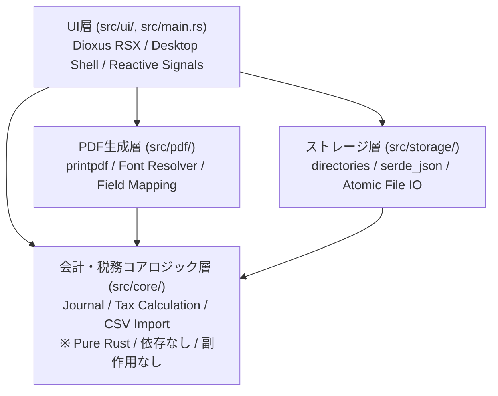

# 確定申告ソフトウェア アーキテクチャ設計書

本書は、`TaxReturnApplication-Dioxus` の**内部ソフトウェア構造、モジュール分離、データ構造、技術選定、およびテスト戦略**をまとめた技術設計書です。

---

## 1. 全体アーキテクチャ概要

### 1.1 レイヤード設計と依存の単方向性
本アプリケーションは、**「UI層」「会計・税務ロジック層」「ストレージ永続化層」「PDF出力層」**を厳格に分離しています。



### 1.2 設計原則
1. **コアロジックの完全な純粋性 (Purity)**:
   - `src/core/` 以下のすべてのモジュールは、UIクレート（Dioxus）や外部入出力（I/O）への依存を持ちません。
   - すべての処理は `fn compute(input: &Input) -> Output` の純粋関数として記述され、モックやGUI環境なしで100%単体テストが可能です。
2. **ライブラリクレートとバイナリクレートの分離**:
   - `src/lib.rs` は `core`, `pdf`, `storage` のみを公開し、UIを含みません。これにより `cargo test --lib --no-default-features` でヘッドレスに全テストが瞬時に完了します。
   - `src/main.rs` はUIおよびデスクトップウィンドウのライフサイクルを担当します。
3. **シングルバイナリ・デリバリー (Single Binary Delivery)**:
   - C/C++ランタイム依存や Node.js / Python などの外部ランタイムを不要とし、最終成果物は単一の実行可能バイナリとしてコンパイルされます。

---

## 2. ディレクトリ・モジュール構成

```
TaxReturnApplication-Dioxus/
├── Cargo.toml               # パッケージ定義・依存関係・プロファイル
├── Dioxus.toml              # Dioxus CLI設定ファイル
├── assets/
│   ├── styles.css           # UIスタイルシート（全画面埋め込み）
│   └── fonts/               # 組み込み候補日本語フォント配置用
├── templates/
│   ├── blue_return_fields.json # 青色申告決算書PDFの座標定義
│   └── form_b_fields.json      # 確定申告書B PDFの座標定義
├── src/
│   ├── lib.rs               # コアライブラリのエントリポイント
│   ├── main.rs              # デスクトップアプリケーション起動・Window構築
│   ├── core/                # 純粋会計・税務計算エンジン
│   │   ├── mod.rs
│   │   ├── journal.rs       # 仕訳モデル、勘定科目・補助科目マスタ、バリデーション
│   │   ├── allocation.rs    # 家事按分エンジン、事業割合計算、振替仕訳生成
│   │   ├── rollover.rs      # 年度繰越エンジン、B/S残高継承、開始仕訳生成
│   │   ├── tax_calc.rs      # 決算書集計、所得税率計算、控除計算
│   │   └── csv_import.rs    # 旧Excel CSV解析、文字コード判定、科目判定
│   ├── storage/             # データ永続化層
│   │   ├── mod.rs
│   │   ├── paths.rs         # OS別標準パス解決 (directories)
│   │   └── json_store.rs    # 年度別JSONアトミック読み書き
│   ├── pdf/                 # PDF出力層
│   │   ├── mod.rs
│   │   ├── field_map.rs     # 座標定義データモデル・JSONローダー
│   │   ├── fonts.rs         # 日本語フォント探索・フォールバック
│   │   └── engine.rs        # printpdfを用いた帳票描画エンジン
│   └── ui/                  # Dioxus RSX UIコンポーネント
│       ├── mod.rs
│       ├── layout.rs        # アプリケーションシェル・3画面ナビゲーション
│       ├── ledger.rs        # 仕訳入力・編集・一覧（補助科目対応）・CSVインポートUI
│       ├── report.rs        # 帳票サマリー表示・納税者情報・PDF出力UI
│       └── closing.rs       # 決算・設定画面（科目管理・家事按分・年度繰越）
└── doc/                     # 仕様書・設計書・ロードマップ
```

---

## 3. 主要データモデル詳細

### 3.1 会計基本モデル (`src/core/journal.rs`)

```rust
// 勘定科目分類
pub enum AccountNature {
    Asset,      // 資産
    Liability,  // 負債
    Equity,     // 純資産
    Income,     // 収益
    Expense,    // 費用
}

// 勘定科目コード (serdeでは snake_case でシリアライズ)
pub enum AccountCode {
    Cash, Bank, AccountsReceivable, AccountsPayable,
    Capital, Drawings, OwnerContribution,
    Sales, CostOfSales, Travel, Communication, Supplies,
    Rent, Utilities, Miscellaneous,
}

// 単一仕訳レコード
pub struct JournalEntry {
    pub id: String,                    // UUID v4
    pub date: NaiveDate,               // 取引日
    pub debit: AccountCode,            // 借方科目
    pub credit: AccountCode,           // 貸方科目
    pub amount: i64,                   // 金額（円）
    pub description: String,           // 摘要
    pub created_at: DateTime<Local>,   // 登録日時
}

// 納税者基本情報
pub struct TaxpayerInfo {
    pub name: String,                  // 氏名
    pub address: String,               // 住所
    pub business_name: String,         // 屋号
    pub phone: String,                 // 電話番号
}

// 1年度分の帳簿ドキュメント (保存ファイルのルート構造)
pub struct LedgerDocument {
    pub version: u32,                  // スキーマバージョン (現行: 2)
    pub fiscal_year: i32,              // 会計年度 (西暦)
    pub entries: Vec<JournalEntry>,    // 仕訳リスト
    pub taxpayer: TaxpayerInfo,        // 納税者情報
    pub special_deduction: BlueSpecialDeductionKind, // 青色特別控除区分
}
```

### 3.2 税務計算モデル (`src/core/tax_calc.rs`)

```rust
// 青色申告特別控除区分
pub enum BlueSpecialDeductionKind {
    None,      // 0円
    Yen100k,   // 10万円
    Yen650k,   // 65万円
}

// 経費内訳
pub struct ExpenseBreakdown {
    pub travel: i64,
    pub communication: i64,
    pub supplies: i64,
    pub rent: i64,
    pub utilities: i64,
    pub miscellaneous: i64,
}

// 青色申告決算書（一般用）集計結果
pub struct BlueReturnSummary {
    pub fiscal_year: i32,
    pub sales: i64,
    pub cost_of_sales: i64,
    pub gross_profit: i64,
    pub expenses: ExpenseBreakdown,
    pub total_expenses: i64,
    pub ordinary_income_before_deduction: i64,
    pub special_deduction_kind: BlueSpecialDeductionKind,
    pub special_deduction: i64,
    pub business_income: i64,
    pub by_account: BTreeMap<String, i64>,
    // 貸借対照表残高
    pub cash: i64,
    pub bank: i64,
    pub accounts_receivable: i64,
    pub accounts_payable: i64,
    pub capital: i64,
    pub drawings: i64,
    pub owner_contribution: i64,
}

// 確定申告書B 所得税概算結果
pub struct FormBSummary {
    pub fiscal_year: i32,
    pub business_income: i64,
    pub total_income: i64,
    pub basic_deduction: i64,
    pub total_deductions: i64,
    pub taxable_income: i64,
    pub income_tax: i64,
    pub reconstruction_surtax: i64,
    pub total_income_tax: i64,
}
```

### 3.3 CSVインポートモデル (`src/core/csv_import.rs`)

```rust
// CSVインポート結果レポート
pub struct CsvImportReport {
    pub entries: Vec<JournalEntry>,    // 正常パースされた仕訳
    pub warnings: Vec<String>,         // 科目代替等の警告メッセージ
    pub errors: Vec<CsvRowError>,      // パース失敗した行のエラー情報
    pub total_data_rows: usize,        // 総データ行数
    pub skipped_rows: usize,           // 空行などスキップされた行数
}

// 行レベルエラー情報
pub struct CsvRowError {
    pub row_index: usize,
    pub line_number: usize,
    pub message: String,
    pub raw_data: String,
}
```

---

## 4. UI状態管理とリアクティビティ

### 4.1 アプリケーションステート (`AppState`)
Dioxus の `use_context_provider` および `Signal<AppState>` を使用して、アプリケーション全体で単一のリアクティブ状態を共有しています。

```rust
pub struct AppState {
    pub fiscal_year: i32,
    pub entries: Vec<JournalEntry>,
    pub taxpayer: TaxpayerInfo,
    pub special_deduction: BlueSpecialDeductionKind,
    pub status_message: Option<String>,
    pub error_message: Option<String>,
}
```

- **自動永続化**: 仕訳の追加・更新・削除、納税者情報の入力、特別控除の変更などのアクションが発生するたびに、バックグラウンドで `save_year` を呼び出し、データの保存忘れを防止。
- **UIフィードバック**: 処理の成功は `status_banner`、バリデーションやI/Oエラーは `error_banner` を通じて即座にユーザーに通知。

### 4.2 Linux / WSL2 デスクトップ環境の描画安定化
Linux環境（特にWSL2やWebKitGTK）で発生しやすい「ウィンドウ内が真っ白になる現象」「ハードウェアアクセラレーションのクラッシュ」を防ぐため、`main.rs` の起動時に以下の環境変数を自動設定しています。

```rust
#[cfg(target_os = "linux")]
{
    std::env::set_var("GDK_BACKEND", "x11");
    std::env::set_var("LIBGL_ALWAYS_SOFTWARE", "1");
    std::env::set_var("WEBKIT_DISABLE_DMABUF_RENDERER", "1");
    std::env::set_var("WEBKIT_DISABLE_COMPOSITING_MODE", "1");
}
```

---

## 5. テスト戦略とテストスイート構成

本プロジェクトでは、会計計算・パース処理・データ永続化の信頼性を担保するため、全34件の単体テストを実装しています。

| テストモジュール | テスト件数 | 主な検証内容 |
|---|:---:|---|
| `core::journal` | 10件 | 仕訳バリデーション（正常系、金額0以下、貸借同科目、補助科目異振替許可、摘要空文字、年度外日付）、千円区切りフォーマット、JSONシリアライズ・デシリアライズ、旧ファイル互換、カスタム科目・補助科目管理 |
| `core::allocation`| 1件 | 家事按分事業割合計算（個人負担額算出）、12月31日振替仕訳自動生成、重複防止・再生成、クリア処理 |
| `core::rollover` | 1件 | 前年末B/S期末残高集計、翌期首元入金算出（前期末元入金＋所得＋事業主借−事業主貸）、1月1日開始仕訳自動生成 |
| `core::tax_calc` | 9件 | 貸借対照表残高集計、売上・全経費集計、青色特別控除（上限キャップ、65万円適用）、課税所得千円切捨て、所得税7段階ブラケット速算、基礎控除段階的逓減、空帳簿のゼロ判定 |
| `core::csv_import` | 3件 | Shift_JIS/UTF-8自動判定、旧Excel2行ヘッダーサンプルの完全パース、新標準科目自動マッピング、摘要2・摘要3の自動結合 |
| `storage::paths` | 1件 | OSデータディレクトリおよび `ledgers/` ディレクトリパス解決 |
| `storage::json_store`| 2件 | ファイル未存在時の空ドキュメント自動生成、アトミック書き込みと読み戻しの整合性 |
| `pdf::field_map` | 3件 | 座標定義のJSONシリアライズ・デシリアライズ、テンプレート未存在時のフォールバック、ファイル自動探索 |
| `pdf::fonts` | 1件 | フォント検索パス配列の妥当性 |
| `pdf::engine` | 3件 | 青色申告決算書および申告書BのPDFバイナリ生成、ファイル出力検証 |
| **合計** | **34件** | **全テスト成功（0 failed）** |

